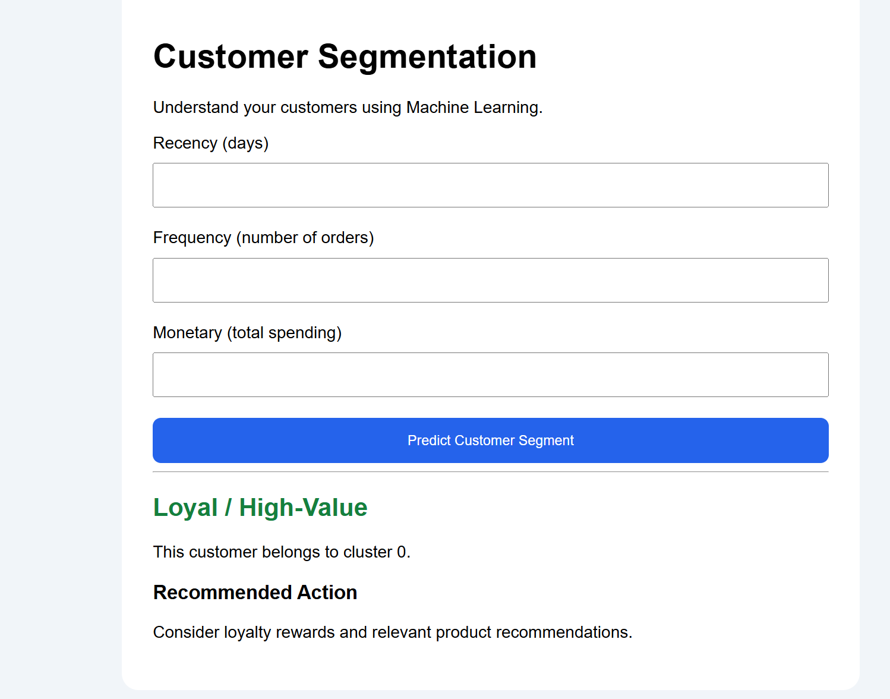

# Customer Segmentation Using Machine Learning

A machine learning project that segments customers based on their purchasing behavior using **RFM Analysis** and **K-Means Clustering**. The project provides a Flask web application that predicts customer segments and suggests suitable marketing strategies.

## Live Demo

**[Try the Live Application](https://customer-segmentation-ml-kfu7.onrender.com)**

### Application Screenshot


## Project Overview

Understanding customer behavior helps businesses improve customer retention, personalize marketing campaigns, and identify high-value customers. This project applies unsupervised machine learning to group customers using their purchase history.

## Key Features

- Customer segmentation using K-Means clustering.
- RFM feature engineering: Recency, Frequency, and Monetary value.
- Log transformation and feature scaling before prediction.
- Flask-based web interface for customer segment prediction.
- Marketing recommendations based on the predicted segment.
- Deployment on Render.

## Technologies Used

- **Language:** Python
- **Machine Learning:** Scikit-learn, K-Means Clustering
- **Data Processing:** NumPy, Pandas
- **Web Framework:** Flask
- **Model Persistence:** Joblib
- **Deployment:** Render
- **Version Control:** GitHub

## Dataset

The project uses the **Online Retail** dataset from the UCI Machine Learning Repository.

[Dataset Source — UCI Machine Learning Repository](https://archive.ics.uci.edu/dataset/352/online+retail)

The dataset contains online retail transactions, including customer IDs, invoice dates, quantities, unit prices, and countries.

## Methodology

1. **Data Cleaning:** Removed duplicate records, missing customer IDs, cancelled invoices, and invalid transaction prices.
2. **RFM Analysis:** Calculated:
   - **Recency:** Days since the customer's most recent purchase.
   - **Frequency:** Number of distinct orders.
   - **Monetary:** Total customer spending.
3. **Preprocessing:** Applied `log1p` transformation and `StandardScaler`.
4. **Model Training:** Trained a K-Means model with two customer segments.
5. **Deployment:** Integrated the saved model and scaler into a Flask application and deployed it on Render.

## Customer Segments

### 1. Loyal / High-Value
Customers who generally purchase more recently, place more orders, and spend more.

**Suggested strategy:** Loyalty rewards and personalized product recommendations.

### 2. At-Risk / Low-Engagement
Customers who generally purchase less frequently, have longer gaps since their last purchase, and spend less.

**Suggested strategy:** Targeted re-engagement campaigns and relevant offers.

*Note: These segments are based on the patterns learned by the clustering model and are not guaranteed labels for every individual customer.*

## Run Locally

Clone the repository:

```bash
git clone https://github.com/sheetalpatel556/customer-segmentation-ml.git
cd customer-segmentation-ml
```

Install dependencies:

```bash
pip install -r requirements.txt
```

Run the Flask application:

```bash
python app.py
```

Open `http://127.0.0.1:5000` in your browser.

## Project Structure

```text
customer-segmentation-ml/
├── app.py
├── final_model.pkl
├── rfm_scaler.pkl
├── requirements.txt
└── README.md
```

## Future Improvements

- Add interactive customer-segment visualizations.
- Provide batch predictions through CSV uploads.
- Improve customer profiles and segment-level analytics.
- Add model evaluation and monitoring.

## Author

**Sheetal Patel**

GitHub: [@sheetalpatel556](https://github.com/sheetalpatel556)
